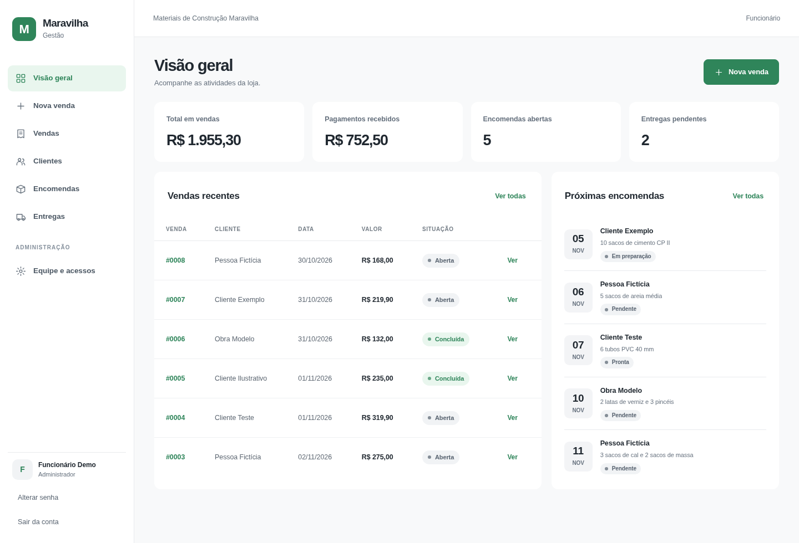

# Maravilha Gestão

Um sistema web para organizar a rotina da Materiais de Construção Maravilha, em Januária (MG). A ideia é reunir vendas, pagamentos, encomendas e entregas num só lugar, para a equipe saber o que já foi feito e o que ainda está pendente.

## O que dá para fazer

- Cadastrar clientes e registrar vendas.
- Anotar pagamentos e conferir quanto falta receber em cada venda.
- Acompanhar encomendas e entregas.
- Gerenciar o acesso dos funcionários.

O sistema roda no próprio computador da loja. Foi feito com Python, Flask, SQLite e Bootstrap.

## Como rodar

Você vai precisar do **Python 3.12 ou mais recente**. Baixe ou clone o repositório antes de seguir os passos.

**No Windows**, execute estes arquivos na ordem:

1. `setup_windows.bat` — instala as dependências.
2. `CRIAR_ADMIN.bat` — cria a primeira conta. Escolha uma senha de pelo menos 12 caracteres.
3. `INICIAR.bat` — abre o servidor local. Nas próximas vezes, basta executar este arquivo.

**No Linux**, abra um terminal na pasta do projeto:

```bash
bash setup_linux.sh
.venv/bin/python -m flask --app app create-admin
.venv/bin/python run.py
```

Com o servidor rodando, abra [localhost:8080](http://127.0.0.1:8080) no navegador do mesmo computador. O banco de dados é criado na primeira execução.

## Uma olhada no sistema



As telas usam dados fictícios. Veja também o [formulário de venda](docs/capturas/tela2_nova_venda.png) e o [resumo de uma venda](docs/capturas/tela3_resultado.png).

## Para consultar depois

- [Guia de uso local](docs/GUIA_LOCAL.md): backups, acesso por outros aparelhos, demonstração e testes.
- [Arquitetura e modelo de dados](docs/ARQUITETURA_E_MODELO.md): como o sistema funciona por dentro.
- [Componentes de terceiros](THIRD_PARTY_NOTICES.md): créditos e licença do Bootstrap.
